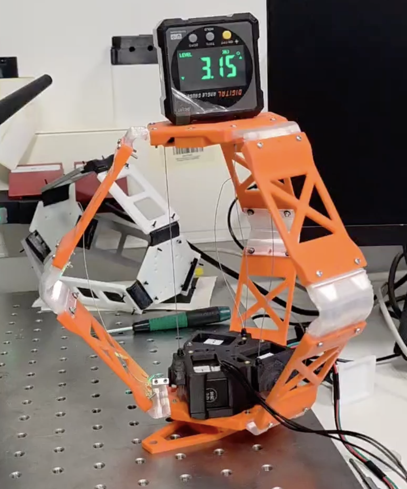

# Development-of-Learning-Based-MPC-for-the-Soft-Robotic-Manipulator

A three-motor soft robot platform for research on learning-based model predictive control (MPC).
This repository collects the hardware design, control code and the data-driven models developed for the platform.

> **Status:** work in progress. The inverse kinematic model (pose → motor positions) is working and validated on recorded data; round-trip tests on the robot and the forward model for MPC are still to do.

## Repository structure

The src folder consists of the following folders.

| Folder | Content |
|---|---|
| [`MATLAB/`](MATLAB) | MATLAB code and Simulink model of the soft robot platform in various instances |
| [`Kinematic_model/`](Kinematic_model) | Neural-network inverse model: desired platform pose → motor positions (Python) |

The soft robot platform structure is given in this figure.


## MATLAB

MATLAB folder contains two folders:
- Simulink: contains the following folders, indicating history of the simulation model development
  - Previous version: early stage Simulink models of the soft robot
  - Robot_model (current version): current stage Simulink models at different scenarios (in development)

## Kinematic_model: pose → motor positions

### What it does

For a desired platform pose, the model predicts the position of the three motors that produces it:

```
pose  = [ z (mm), roll (deg), pitch (deg) ]   relative to the rest position
rate  = d(pose)/dt of the desired trajectory  (from the MPC reference; zeros for a static query)
output = [ m1, m2, m3 ]                       motor positions (deg)
```

It is meant for MPC design: as a feedforward / warm start for the motor input, to let the optimizer work in pose space, or as a building block next to a forward model. A CasADi export is included so the network can be used inside an NLP.

### Data

Two recordings of the same motion protocol are used (files in `Kinematic_model/dataset/`):

| File | Content |
|---|---|
| `softri_ml_dataset_20261008_111120.csv` | 30 Hz log: motor positions (deg), motor currents (mA), IMU roll/pitch (deg), ~61 s |
| `Data_Col.csv` | 120 Hz motion-capture export of a 3-marker plate on the platform, ~73 s |

The protocol is a sequence of trapezoidal motor sweeps: all three motors together, each motor alone, then each pair of motors.

**Why both files are needed.** The IMU only gives roll and pitch. Pulling all three motors equally lowers the platform (up to about 98 mm) without any tilt, so roll/pitch alone cannot determine the motor positions. The mocap provides the missing platform height.

**Fusion.** The mocap is aligned to the motor log with one constant time offset (about 7.86 s) and one yaw angle between the marker frame and the IMU frame, both fitted by least squares against the IMU. After alignment the mocap tilt and the IMU tilt agree to about 0.18° RMSE.

### Method

1. **Shared network with 3-fold symmetry.** A single small MLP (2 hidden layers × 24 tanh units, ensemble of 5) is shared by the three motors. Motor *i* receives the platform height, the tilt along its own tendon direction, the tilt across it, and motion flags. The data only covers seven straight paths in motor space, and this weight sharing is what lets the model handle unseen directions.
2. **Motion flags for hysteresis.** `tanh` of the desired-pose rate tells the network whether the tendons are winding or unwinding. No motor measurement is used as input.
3. **Validation by held-out segments.** Random train/test splits leak because neighbouring samples are almost identical, so each motion segment is held out in turn.

### Results (leave-one-segment-out, motor RMSE in degrees)

| Held-out segment | m1 | m2 | m3 | m1+m2 | m1+m3 | m2+m3 | mean |
|---|---|---|---|---|---|---|---|
| RMSE (deg) | 3.1 | 4.1 | 4.5 | 3.6 | 4.0 | 6.4 | **4.3** |

The motor travel is about 600°, so this is roughly 1 % of the range. In-sample RMSE is 2.1°. The "all three motors" sweep is not tested this way because it reaches heights nobody else covers (extrapolation); it is included in the final training.

### Quick start (macOS / Linux)

Run everything from inside `Kinematic_model/`.

```bash
python3 -m venv .venv
source .venv/bin/activate
python -m pip install numpy pandas scipy scikit-learn matplotlib
# optional, for the MPC export (may lack wheels for the newest Python versions):
python -m pip install casadi

python softri_inverse_model.py \
  --mocap dataset/Data_Col.csv \
  --motors dataset/softri_ml_dataset_20261008_111120.csv \
  --out .
```

This builds the fused dataset, prints the held-out errors, trains the final model and writes:

| Output | Content |
|---|---|
| `softri_fused_dataset.csv` | aligned pose (z, roll, pitch) and motor data |
| `softri_inverse_weights.npz` | trained network weights |
| `softri_inverse_loso.png` | measured vs predicted motor positions for held-out segments |

### Using the model

```python
from softri_inverse_model import *

df, rest = build_dataset("dataset/Data_Col.csv",
                         "dataset/softri_ml_dataset_20261008_111120.csv")
pose = df[["z", "roll", "pitch"]].values
rate = pose_rate(pose)
model = InverseModel(seeds=5).fit(pose, rate, df[["m1", "m2", "m3"]].values)

# desired pose: z = -40 mm, roll = 5 deg, pitch = -8 deg, held still
motors = model.predict_rel(np.array([[-40, 5, -8]]), np.zeros((1, 3))) + rest
print(motors)          # absolute motor positions in degrees

# CasADi function f(pose[3], rate[3]) -> motors_deg[3] for use in an MPC
f = model.to_casadi(rest)
```

`use_model.py` contains this example.


### Roadmap

- [ ] Round-trip test on the robot (command predicted motors, read IMU / mocap)
- [ ] Record random multi-motor ramps at several speeds to cover the space between the current sweeps
- [ ] Forward model (motors → pose) for use as the MPC prediction model
- [ ] Small CasADi MPC example using the inverse model

## Related literature

The design of the model and the planned MPC build on:

- T.-L. Habich et al., "Generalizable and Fast Surrogates: Model Predictive Control of Articulated Soft Robots Using Physics-Informed Neural Networks," *IEEE Transactions on Robotics*, vol. 42, 2026.
- H. Schäfke et al., "Learning-Based Nonlinear Model Predictive Control of Articulated Soft Robots Using Recurrent Neural Networks," *IEEE Robotics and Automation Letters*, vol. 9, no. 12, 2024.
- M. T. Gillespie et al., "Learning Nonlinear Dynamic Models of Soft Robots for Model Predictive Control with Neural Networks," *IEEE International Conference on Soft Robotics (RoboSoft)*, 2018.
- D. Piga et al., "Performance-Oriented Model Learning for Data-Driven MPC Design," *IEEE Control Systems Letters*, vol. 3, no. 3, 2019.

## Acknowledgment

The following work is conducted under the project of supervision of Dr. Gourav Moger and PI Hussein Atakan Varol at Advanced Robotic and Mechatronic Systems Lab in Nazarbayev University.

## License

MIT — see [LICENSE](LICENSE).
